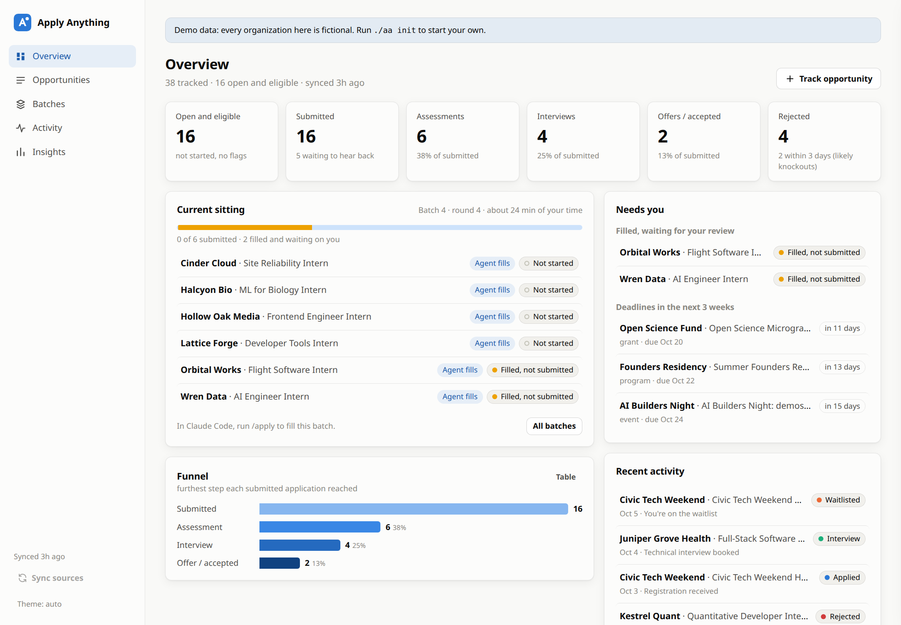
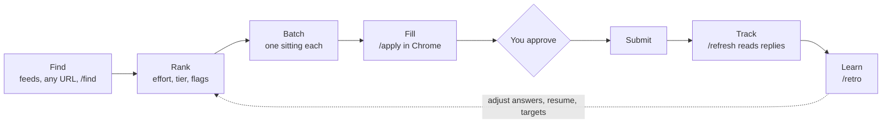
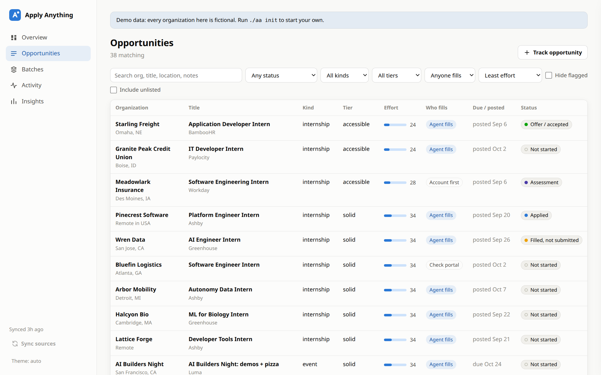
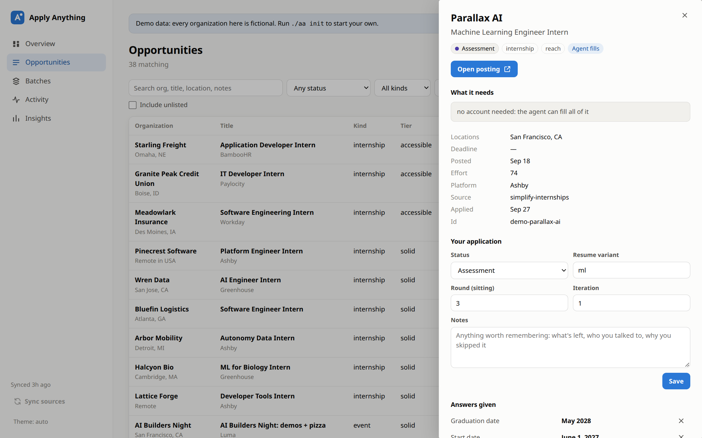
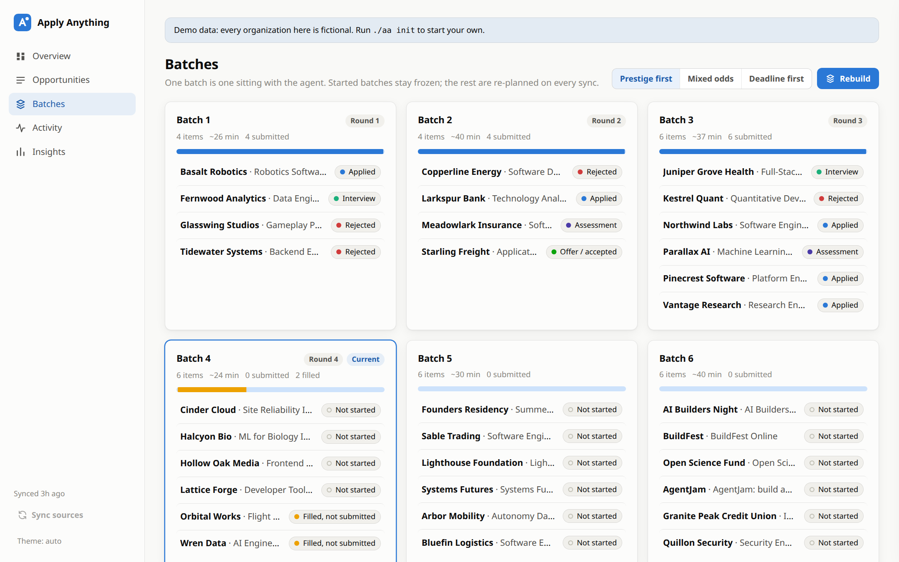
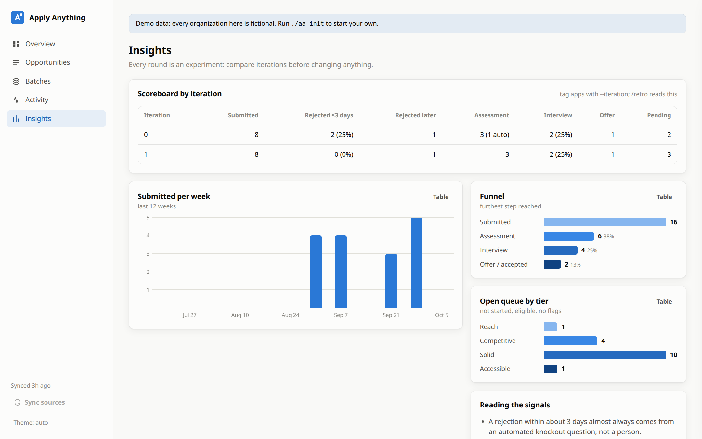

<p align="center">
  
</p>

# Apply Anything

[](https://github.com/prithvirajmody/apply-anything/actions/workflows/tests.yml)

**An AI agent that applies to things for you, and a dashboard to keep it honest.**

Internships, jobs, hackathons, fellowships, scholarships, grants, accelerators, events: if
it has a form, Apply Anything can find it, rank it, fill it, and track what happens next.

- **Finds** opportunities from live feeds (SimplifyJobs, Greenhouse, Lever and Ashby job
  boards, Devpost hackathons) or any link you paste. `/find` searches the web for the rest.
- **Ranks** each one by effort and odds, flags the ones you can't apply to, and works out
  who has to do what: no-account forms the agent fills alone, portals that need your
  account first, how many essays a form asks for.
- **Fills** every form in a real Chrome window, from one profile file with your answers,
  using playbooks for each platform's quirks (Workday, Greenhouse, Ashby, Lever, iCIMS,
  Avature, SmartRecruiters, Phenom, Oracle, amazon.jobs, Luma, Partiful and more).
- **Stops before Submit.** You review, you approve, then it submits. CAPTCHAs, signatures,
  legal attestations and anything you haven't answered stay with you.
- **Tracks** replies from your inbox (confirmations, assessments, interviews, rejections,
  offers, waitlists) on one timeline per application.
- **Learns.** Each round is an experiment: it records the knockout answers you gave, then
  `/retro` works out why things were rejected or advanced and what to change next.

Built and battle-tested during a real internship application season. The agent side
runs on [Claude Code](https://claude.com/claude-code); the tracker, ranking and UI are
plain Python with no dependencies.

## How it works



| Step | What happens | Command |
|---|---|---|
| Find | Pull every configured source; add anything else by URL | `./aa sync`, `./aa add <url>`, `/find` |
| Rank | Effort 0–100, tier, eligibility flags, who fills it, essay and cover-letter counts read from the form | `./aa rank` |
| Batch | Group open opportunities into sittings (default 10), one per organization. Started batches stay frozen | `./aa batch --mode prestige\|mixed\|deadline` |
| Fill | The agent drives Chrome over CDP, screens each posting, fills it from your packet, records the knockout answers it gave, and stops before Submit | `/apply` |
| Track | Scan your inbox, classify replies, move statuses forward, never double-count an email | `/refresh` |
| Learn | Scoreboard per iteration; knockout-answer diagnosis; hypotheses that need three outcomes before you act | `/retro`, `./aa stats` |

## Quick start

```bash
git clone https://github.com/prithvirajmody/apply-anything
cd apply-anything
./aa ui --demo        # look around first: fictional data, opens http://127.0.0.1:8766
./aa init             # create profile/ (git-ignored) from examples/profile
```

Edit three files in `profile/`:

- `config.toml`: your name and links, which sources to pull, tier lists, eligibility rules.
- `packet.md`: every answer a form might ask for, plus the rules for essays.
- `resume.json`: resume content. `./aa resume profile/resume.json` builds the PDF.

Then:

```bash
./aa sync             # pull, rank, build batches
./aa ui               # http://127.0.0.1:8765
```

In Claude Code, from this folder: `/apply` fills the current batch, `/refresh` checks your
inbox, `/retro` explains the results, `/find hackathons this month` looks for more.

**Requirements:** Python 3.11+ (standard library only). Google Chrome or Chromium for the
agent. Optional: LibreOffice for PDF resumes and cover letters; an email connector (such
as Gmail) in Claude Code for `/refresh`.

## The dashboard

`./aa ui` serves a local web app on `127.0.0.1`. Nothing leaves your machine.

| | |
|---|---|
|  |  |
| **Opportunities**: search and filter everything you track by status, kind, tier and who fills it. | **Details**: status, notes, the knockout answers you gave, and the full timeline. |
|  |  |
| **Batches**: one card per sitting; rebuild by prestige, mixed odds or deadline. | **Insights**: the scoreboard by iteration, weekly volume, the funnel. |

It also runs well on a phone, and has light and dark themes.

## Your profile

Everything personal lives in `profile/`, which is git-ignored:

| File | What it is |
|---|---|
| `config.toml` | Identity for document headers, sources, tiers, keywords, eligibility, batch settings |
| `packet.md` | The agent's only source of answers: contact details, education, work-authorization wording, standard answers, work history, skills, a story bank for essays, and what to leave out |
| `resume.json`, `letters.json` | Resume and cover-letter content, built to .docx and .pdf |
| `iteration-log.md` | Your experiment log: hypotheses, changes, results |
| `aa.db` | The tracker database (SQLite). Change it through `./aa` or the UI |
| `files/` | Generated resumes and letters |

Set `AA_HOME` to keep the profile somewhere else.

## Sources

| Type | What it pulls | Example config |
|---|---|---|
| `simplify` | The SimplifyJobs internship and new-grad lists, filtered by term, category, age and degree | `repo = "SimplifyJobs/Summer2027-Internships"` |
| `greenhouse` | Every posting on the boards you name, filtered by title | `boards = ["stripe"]`, `include = ["intern"]` |
| `lever` | Every posting for the companies you name | `companies = ["palantir"]` |
| `ashby` | Every posting for the organizations you name | `orgs = ["ramp"]` |
| `devpost` | Open and upcoming hackathons, by theme | `themes = ["Machine Learning/AI"]` |
| by hand | Anything with a URL: fellowships, grants, scholarships, events, programs | `./aa add <url>`, `./aa import list.csv` |

A new source is one Python file with a `fetch()` function; see
[docs/how-it-works.md](docs/how-it-works.md).

## How ranking and batching decide

- **Effort** starts from the tier's base (reach 82, competitive 62, solid 42, accessible
  24), drops 8 when the title fits your profile, rises 10 when it's far from it, +4 for a
  portal that needs an account, +4 per required essay and +8 for a required cover letter.
- **Flags** keep things out of batches but visible: requires citizenship, no visa
  sponsorship (only if you need it), outside your countries, deadline passed. Ineligible
  titles (wrong degree or year) score zero.
- **Batches** take one opportunity per organization, skip repeat postings, freeze once
  you've started them, and order by `prestige` (reach first), `mixed` (2/3/3/2 across
  tiers), or `deadline` (soonest first, for hackathons and fellowships). Within a tier,
  better fit, fresher postings and no-account forms come first.

## Responsible use

- **You are the applicant.** The agent answers only from your packet and your resume, never
  invents experience, and leaves blanks rather than guessing.
- **Human checks stay human.** CAPTCHAs, "are you a person" questions, emailed security
  codes (it can find the email and show you the code), signatures, attestations, waivers
  and legal acknowledgments are always yours.
- **Nothing is submitted without your OK** for that application or that batch.
- **Pace and terms.** It fills one form at a time, at about human speed, in your own browser
  session. It is not a mass-submission bot. Respect each site's terms and each employer's
  application limits (the packet has a place to record them).
- **Your data stays local.** The profile, the database and generated documents never leave
  your machine, except what you choose to put in a form. The UI listens on 127.0.0.1 only.

## Commands

| Command | Does |
|---|---|
| `./aa init` | Create `profile/` from the examples |
| `./aa sync [--source NAME]` | Pull sources, rank, rebuild batches |
| `./aa add URL [--kind --deadline --org --title --note]` | Track anything by URL (looks up Greenhouse, Lever and Ashby postings) |
| `./aa import FILE.csv` | Add many (`url, org, title, kind, deadline, location, note`) |
| `./aa list [--status --kind --tier --q --batch N --json]` | List and filter |
| `./aa show ID` | One opportunity with its application and timeline |
| `./aa set ID --status S --answer "Q=A" --variant V --round N --iteration N` | Update your application |
| `./aa event ID --status S --text T --msg ID` | Add a timeline event; moves status forward, dedupes by message id |
| `./aa batch [--mode M] [--dry-run]` · `./aa next` | Rebuild or preview batches · the current one |
| `./aa stats` | Funnel and scoreboard |
| `./aa resume FILE.json` · `./aa letters FILE.json` | Build documents (.docx, plus .pdf with LibreOffice) |
| `./aa export [--format csv]` | Dump everything |
| `./aa ui [--demo]` | The dashboard |

## Project layout

```
aa                     CLI launcher (no install needed)
applyanything/         Python package: db, rank, batch, sources/, docs, server, ui/
.claude/skills/        /apply, /refresh, /retro, /find for Claude Code
playbooks/             How to fill each platform's forms (read by the agent)
docs/                  How it works, knockout questions, outreach
examples/profile/      Templates that ./aa init copies into profile/
tests/                 python3 -m unittest discover -s tests
```

## More

- [docs/how-it-works.md](docs/how-it-works.md): data model, ranking, batching, the UI's
  security model, adding a source.
- [docs/knockout-questions.md](docs/knockout-questions.md): why fast rejections happen and
  how to answer graduation, start-date, GPA and work-authorization questions.
- [docs/outreach.md](docs/outreach.md): referrals and emailing founders directly.
- [playbooks/](playbooks/README.md): per-platform form-filling notes.

Contributions are welcome, especially new sources and playbooks for platforms not covered
yet. Please keep examples fictional, and never include anyone's real answers or data. By
submitting a contribution, you agree that it may be distributed under this project's license
and under commercial licenses offered by the author.

## License

**Free for personal, noncommercial use.** Run it for your own applications, study it, change
it, and share it, as long as it isn't for a commercial purpose.

**Commercial use needs a paid license.** That includes using it in or for a business, for
example a recruiting or staffing agency, a paid application or career-coaching service, or a
product built on it. To ask about a commercial license, open an issue titled "Commercial
license" or reach out through the contact details on
[my GitHub profile](https://github.com/prithvirajmody).

The terms are the [PolyForm Noncommercial License 1.0.0](LICENSE). Under them, charities,
schools, public research organizations and government bodies may also use it for free. This
summary isn't legal advice; the LICENSE file governs.
